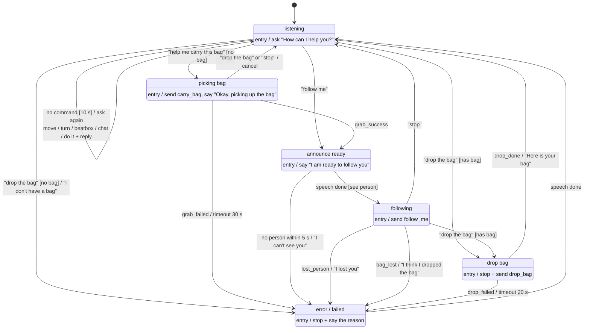

# Robot task flow (state chart) + event interface

Implemented in `voice_assistant/flow_node.py` (`FlowLogic`). Replaces the wake-word dialog. No wake word: the robot
starts in **listening** and asks "How can I help you?" again after 10 s of silence.



## Changes vs. the team's original drawing
| # | Original | Changed to | Why |
|---|---|---|---|
| 1 | following --not see the bag--> drop bag | following --bag_lost--> error ("I think I dropped the bag") | If the bag is gone there is nothing to drop; tell the user instead |
| 2 | picking bag --drop the bag--> error | picking bag --drop the bag / stop--> listening (cancel) | The user changed their mind; that is not a failure |
| 3 | error response arrow unclear | error: stop + say the reason → when speech ends → listening | One clear path out of error |
| 4 | stop only from following | "stop" works in **every** state | Safety |
| 5 | no timeouts | grab 30 s, drop 20 s, person 5 s → error | If a robot node never answers, the voice system must not hang |

## Interface for teammates' nodes

**The voice side sends** `/robot/command` (`std_msgs/String`, JSON):
| action | when | params |
|---|---|---|
| `carry_bag` | entering picking bag | – |
| `follow_me` | entering following | – |
| `drop_bag` | entering drop bag | – |
| `stop` | "stop", entering error, cancel | – |
| `move_forward` / `move_backward` | in listening | `distance` (m), optional `speed` (m/s) |
| `turn` | in listening | `angle` (degrees, left +, right −) |
| `go_to` / `look_at` | in listening | `target` (text) |

`command_bridge_node` also turns `carry_bag` / `drop_bag` into `std_msgs/Empty` on `/robot/carry_bag` / `/robot/drop_bag`.

**The robot side sends back** `/robot/event` (`std_msgs/String`, one word):
| event | who sends it | when | flow reaction |
|---|---|---|---|
| `grab_success` (also accepted: `grab_done`, `pick_success`) | gripper node | bag is held | picking bag → announce ready |
| `grab_failed` | gripper node | could not grab | → error |
| `drop_done` (also accepted: `drop_success`) | gripper node | bag released | drop bag → listening ("Here is your bag") |
| `drop_failed` | gripper node | could not release | → error |
| `see_person` | person detector | person in view (send repeatedly, e.g. 1–10 Hz) | allows announce ready → following |
| `lost_person` | person detector | person no longer in view | following → error ("I lost you") |
| `bag_lost` | basket / weight sensor | bag fell out while carrying | following → error ("I think I dropped the bag") |

Unknown event names are only logged and ignored (no crash). Aliases are listed above.

### Arm (status 9 Nov 2026)
- The arm subscribes `/robot/carry_bag` and `/robot/drop_bag`, and replies `grab_success`/`grab_failed`, `drop_done`/`drop_failed`.
- The arm currently gets the object position **only from the blue box (interactive marker) in RViz**: drag it onto the object
  **before** saying "pick up the bag". When the camera node is ready it will publish the position instead (no change on the voice side).
- Timeouts: grab 30 s, drop 20 s (SO-100 API: pick ~12–18 s, place ~8–12 s).
- "stop" now also calls the arm's `/arm/stop` service (`std_srvs/Trigger`), so the arm freezes too (not only the wheels).

### Arm API v2 (`/arm/*`, see `so100-arm-api.md`) — status 10 Nov 2026
The arm team added actions `/arm/pick`, `/arm/place`, `/arm/pick_place`, `/arm/home` + `/arm/stop`, `/arm/state`.
The old topics above keep working; nothing has to change yet. Moving the voice side to the actions would give:
- a direct result (`success`, `error_code`, English `message` the robot can say) instead of events + timeouts
- clear failure reasons: `UNREACHABLE`, `TOO_WIDE`, `MISSED`, `COLLISION`, `BUSY`, `HOLDING`, `NOT_HOLDING`, `HOT`
Needed first: the object position (`PoseStamped`) for `/arm/pick` and a drop position for `/arm/place` — from the camera
(then someone must publish the camera → `base` TF) or a fixed default. Units: metres, radians.
- When testing with the real arm, turn off simulated events in the sim (`voice_rviz_sim ... simulate_events:=false`,
  or don't run `turtlesim_bag_sim`), otherwise a fake `grab_success` arrives before the arm has finished.

Test any event by hand:
```bash
ros2 topic pub --once /robot/event std_msgs/msg/String "{data: 'grab_success'}"
ros2 topic echo /flow/state
```

In the turtlesim sim, `turtlesim_bag_sim` fakes these events: `grab_success` and `drop_done` 1 s after the command,
and `see_person` every second (`simulate_person:=false` to test "I can't see you").

## Settings (`params.yaml` → `flow_node`)
`ask_text`, `ready_text`, `reask_s` (10), `grab_timeout` (30), `drop_timeout` (20), `person_timeout` (5),
`require_person` (true; false = start following without `see_person`).
